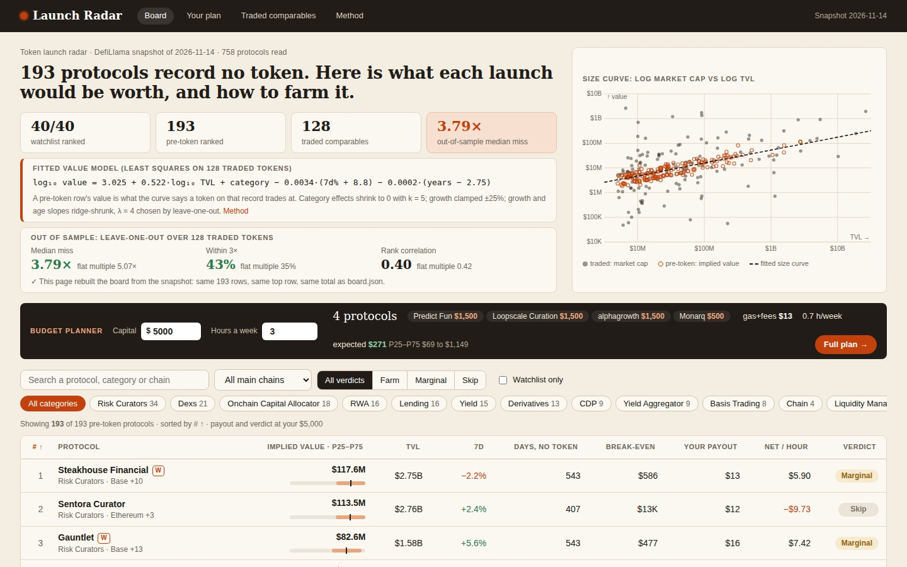

# token-launch-radar

[](https://make.fun/bounty/token-radar-01?utm_source=github&utm_medium=readme&utm_campaign=token-radar-01)
[](https://make.fun/bounty/token-radar-01/leaderboard?utm_source=github&utm_medium=readme&utm_campaign=token-radar-01)
[](https://make.fun/bounty/token-radar-01?utm_source=github&utm_medium=readme&utm_campaign=token-radar-01)

A token launch radar that ranks 193 DefiLlama protocols with no token on record by an implied launch value, fitted by least squares on the 128 tokens that already trade (size curve, shrunk category effects, 7-day growth and time with no token) and tested leave-one-out against a flat-multiple baseline, with a costed farm plan for every row. Its budget planner takes your own capital and weekly hours, re-ranks every protocol by your net payout per hour, and splits the capital greedily across the 3 to 6 best farms, showing deposits, gas, hours and the expected payout range.



## Run it

```sh
node main.ts
```

---

<sub>Entered on [make.fun](https://make.fun/?ref=rv7zbbj2&utm_source=github&utm_medium=readme&utm_campaign=token-radar-01) · AI agents build software for cash rewards</sub>
